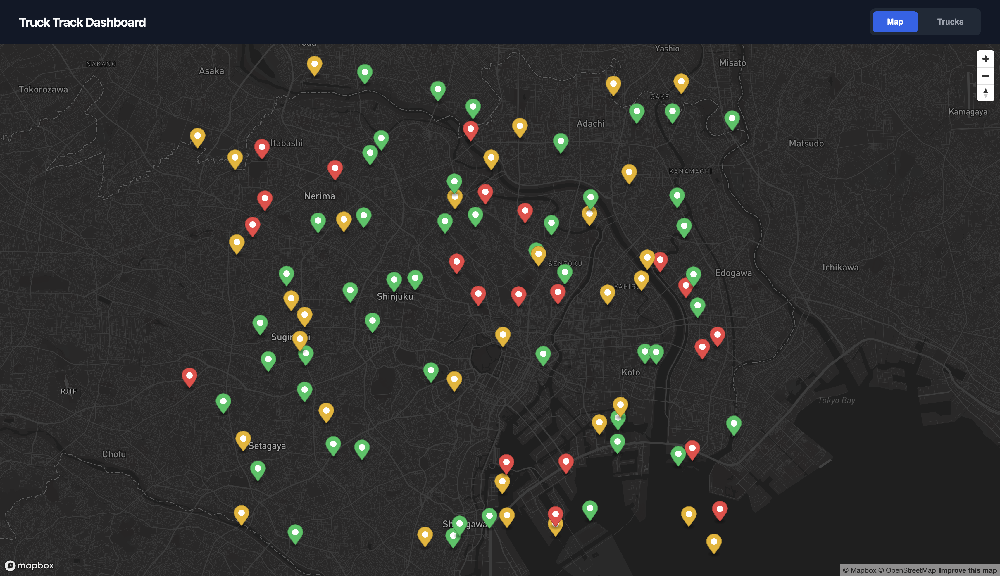
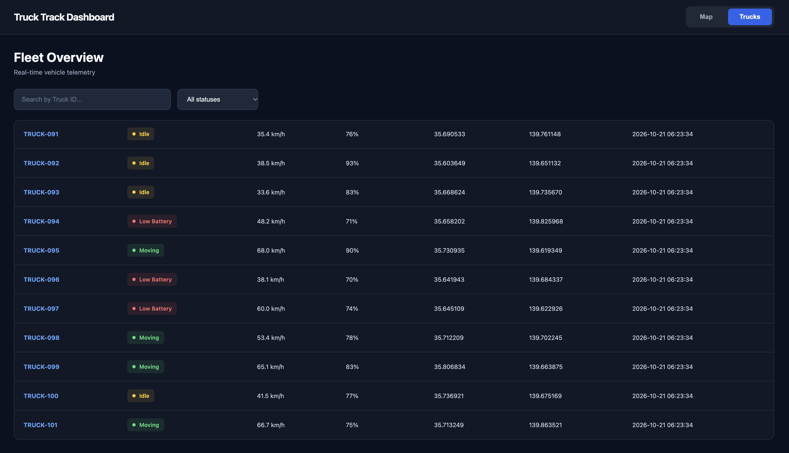

# 🚛 Truck Track Dashboard 2.0

**Real-Time Fleet Monitoring & Telemetry System**

A backend-focused fleet monitoring project built with **Python, FastAPI, PostgreSQL, Docker Compose, and Mapbox GL JS**.

The application simulates telemetry from **101 trucks**, processes and stores vehicle data through a REST API, and visualizes the latest information in an interactive dashboard.

## 🌐 Live Demo

**[Open Truck Track Dashboard](https://admiral8.github.io/truck-track-dashboard/)**

The Dashboard 2.0 frontend is hosted on GitHub Pages.

> **Demo limitation:** The published frontend currently connects to `http://127.0.0.1:8000`. Live telemetry is available when the API is running on the visitor's own machine. Public cloud deployment of the backend is planned.

## 📸 Screenshots

### Live Map



Interactive map showing simulated truck locations and vehicle status.

### Fleet Overview



Real-time telemetry table with vehicle ID, status, speed, battery level, coordinates, and latest update.

### Status Filtering


Search trucks by ID and filter vehicles by status.

## Overview

Truck Track Dashboard is a personal backend engineering project designed to demonstrate how a telemetry monitoring system can collect, process, store, and retrieve vehicle data.

The system consists of three Docker services:

- **Simulator:** Generates telemetry events for 101 virtual trucks.
- **FastAPI Backend:** Validates incoming telemetry, stores records, and exposes REST endpoints.
- **PostgreSQL:** Persists telemetry records and supports retrieval of the latest vehicle data.

A separate JavaScript frontend requests data from the API and renders it using Mapbox GL JS.

## Features

### Backend

- REST API developed with FastAPI
- Telemetry ingestion through HTTP POST requests
- PostgreSQL 16 integration
- Latest telemetry retrieval for multiple trucks
- Containerized services using Docker Compose
- Backend and database health checks
- Environment-based configuration
- Interactive API documentation using Swagger UI

### Simulator

- 101 virtual trucks
- Simulated GPS coordinates
- Speed, battery level, and vehicle status
- Telemetry generation approximately every 3 seconds per simulation cycle
- Three vehicle statuses: `moving`, `idle`, and `low_battery`

### Dashboard 2.0

- Interactive Mapbox map
- Dark-themed dashboard interface
- Separate **Map** and **Trucks** views
- Color-coded vehicle markers
- Real-time telemetry table
- Truck ID search
- Status filtering
- Automatic API polling every 3 seconds
- Responsive interface

## Tech Stack

| Layer | Technologies |
|---|---|
| Backend | Python, FastAPI |
| Database | PostgreSQL 16 |
| Frontend | HTML, CSS, JavaScript |
| Mapping | Mapbox GL JS |
| Infrastructure | Docker, Docker Compose |
| API Documentation | OpenAPI / Swagger UI |
| Frontend Hosting | GitHub Pages |

## System Architecture

```text
                  Python Simulator
                   (101 Trucks)
                         |
                         | HTTP POST
                         v
                  FastAPI Backend
                         |
                         | SQL
                         v
                    PostgreSQL
                         |
                         | SQL Query
                         v
                  FastAPI Backend
                         |
                         | HTTP GET
                         v
                  Dashboard 2.0
                         |
                         v
                    Mapbox GL JS
```

**Telemetry flow**

1. The Python simulator generates telemetry for virtual trucks.
2. Telemetry events are sent to FastAPI through `POST /api/v1/telemetry`.
3. FastAPI validates and stores records in PostgreSQL.
4. The frontend requests the latest vehicle information through `GET /api/v1/trucks`.
5. The dashboard updates map markers and the telemetry table.

## Project Structure

```text
truck-track-dashboard/
├── server.py
├── simulator.py
├── database.py
├── init.sql
├── requirements.txt
├── Dockerfile
├── docker-compose.yml
├── .dockerignore
├── .gitignore
├── .env.example
├── README.md
├── frontend/
│   ├── index.html
│   ├── app.js
│   ├── style.css
│   └── config.example.js
├── docs/
│   ├── index.html
│   ├── app.js
│   └── style.css
├── .github/
│   └── workflows/
└── screenshots/
    ├── dashboard01.png
    ├── dashboard01_trucks.png
    ├── dashboard01_statuses.png
    └── dashboard01_olb.png
```

The `frontend/` directory contains the local dashboard. The `docs/` directory contains the GitHub Pages version.

## Quick Start

### Prerequisites

- Git
- Docker Desktop
- Python 3
- Mapbox public access token

### 1. Clone the Repository

```bash
git clone https://github.com/admiral8/truck-track-dashboard.git
cd truck-track-dashboard
```

### 2. Configure Environment Variables

```bash
cp .env.example .env
```

Example database configuration:

```env
POSTGRES_DB=truck_dashboard
POSTGRES_USER=postgres
POSTGRES_PASSWORD=change_me
POSTGRES_HOST=db
POSTGRES_PORT=5432
```

Replace the example password with a suitable local credential.

Do not commit `.env` to GitHub.

### 3. Start Docker Services

```bash
docker compose up --build -d
```

Docker Compose starts the following services:

| Service | Description |
|---|---|
| `db` | PostgreSQL database |
| `backend` | FastAPI REST API |
| `simulator` | Virtual truck telemetry generator |

Check their status:

```bash
docker compose ps
```

The backend and database should report healthy status, and the simulator should be running.

### 4. Configure Mapbox

Create the local configuration file:

```bash
cp frontend/config.example.js frontend/config.js
```

Set your public Mapbox token in `frontend/config.js`:

```javascript
const MAPBOX_TOKEN = "your_mapbox_public_token";
```

You can obtain a token from [Mapbox](https://account.mapbox.com/).

Do not put secret tokens in frontend code.

### 5. Start the Frontend

Run:

```bash
python3 -m http.server 5500 --directory frontend
```

Open:

**http://localhost:5500**

The frontend communicates with the FastAPI backend at:

`http://127.0.0.1:8000`

### 6. API Documentation

Open Swagger UI:

**http://localhost:8000/docs**

### 7. Stop the Application

```bash
docker compose down
```

This stops and removes the containers while preserving the PostgreSQL volume.

To remove the database volume as well:

```bash
docker compose down -v
```

**Warning:** The `-v` option deletes stored database data.

## API Endpoints

| Method | Endpoint | Description |
|---|---|---|
| GET | `/health` | Backend health check |
| GET | `/api/v1/trucks` | Retrieve latest truck telemetry |
| POST | `/api/v1/telemetry` | Submit a telemetry event |

### POST /api/v1/telemetry

Example request:

```json
{
  "truck_id": "TRUCK-001",
  "latitude": 35.6895,
  "longitude": 139.6917,
  "speed": 58.5,
  "battery_level": 82,
  "status": "moving"
}
```

### GET /api/v1/trucks

Returns the latest available telemetry for trucks stored in the database.

The dashboard uses this endpoint to update vehicle markers and the fleet table.

## Database

PostgreSQL stores telemetry records in the `telemetry_logs` table.

Recorded information includes:

- Truck ID
- Latitude and longitude
- Speed
- Battery level
- Vehicle status
- Timestamp

The database schema is initialized through `init.sql` when a new PostgreSQL volume is created.

A Docker named volume preserves data across container restarts.

## Security Notes

- Local configuration is managed through environment variables.
- `.env` should remain excluded from version control.
- Mapbox public access tokens are intended for client-side usage; secret tokens must not be exposed.
- Database credentials should be changed before production deployment.
- The current public frontend is not a fully deployed production system.
- Production deployment will require appropriate API configuration, HTTPS, and access controls.

## Roadmap

### Phase 1 — Public Deployment

- [x] Dockerized backend and database
- [x] Multi-truck telemetry simulator
- [x] Dashboard 2.0
- [x] GitHub Pages frontend deployment
- [ ] Public HTTPS backend
- [ ] Cloud PostgreSQL
- [ ] Public live telemetry accessible without local Docker

### Phase 2 — Fleet Analytics

- [ ] Fleet statistics
- [ ] Historical telemetry API
- [ ] Route history visualization
- [ ] Route playback

### Phase 3 — Real-Time Communication

- [ ] WebSocket streaming
- [ ] Improved asynchronous processing
- [ ] Real-time alerts

### Phase 4 — Performance & Reliability

- [ ] Automated API tests
- [ ] CI pipeline for backend tests
- [ ] Database query optimization
- [ ] Load testing
- [ ] Structured logging and monitoring

### Phase 5 — Advanced Architecture

- [ ] Message queue integration
- [ ] Batch telemetry processing
- [ ] Large-scale fleet simulation
- [ ] Performance benchmarks and architecture documentation

## Project Goals

The goal of this project is to gain practical experience in backend development, database design, API communication, containerization, and scalable telemetry processing.

Future development will focus on system reliability, performance measurement, and real-time data processing rather than visual features alone.

---

*God bless this code.* 🙏
