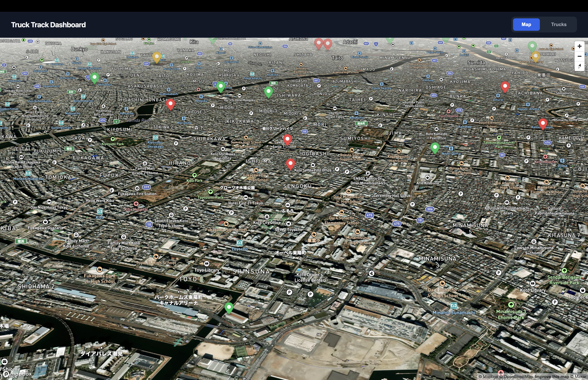
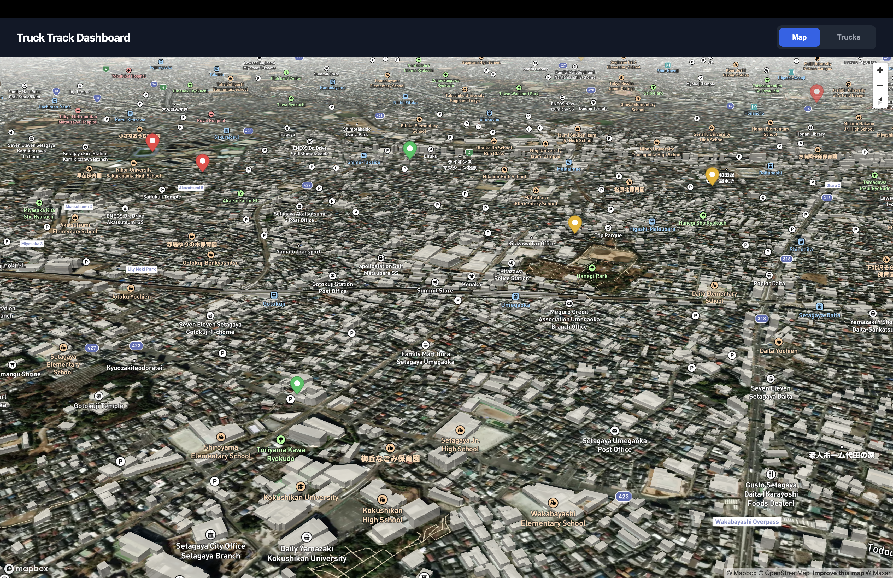
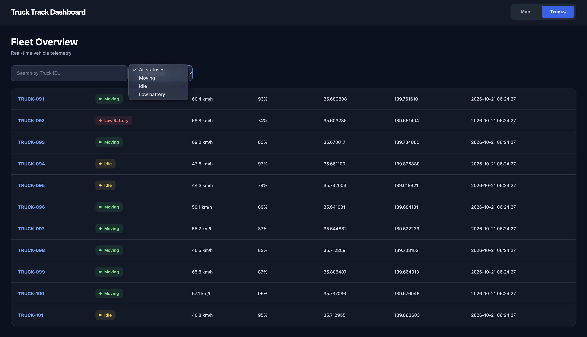
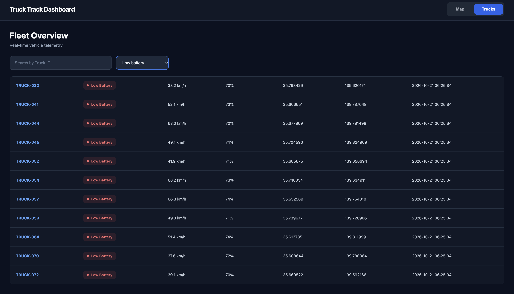

# 🚛 Truck Track Dashboard 2.0

**Real-Time Fleet Monitoring & Telemetry System**

A backend-focused fleet monitoring application built with **Python, FastAPI, PostgreSQL, Docker Compose, and Mapbox GL JS**.

The project simulates telemetry data from **101 virtual trucks**, processes and stores vehicle information through a REST API, and visualizes the latest telemetry on an interactive dashboard.

## 🌐 Live Demo

🚛 **[Open Truck Track Dashboard](https://admiral8.github.io/truck-track-dashboard/)**

Dashboard 2.0 is deployed to GitHub Pages.

> **Note:** The frontend is publicly accessible, but live telemetry currently requires a locally running FastAPI backend at `http://127.0.0.1:8000`. Public backend deployment is planned.


## 📸 Screenshots

### 🌍 Dashboard Overview



Full dashboard view featuring the upgraded Mapbox Satellite 3D map, live vehicle tracking, and an improved user interface.

### 🏙️ Satellite 3D Map



Detailed satellite view with 3D buildings, realistic terrain imagery, tilted camera perspective, and color-coded vehicle markers.

### Status Filtering



Search for individual trucks and filter by vehicle status.

### Low Battery Monitoring



Filter vehicles with low battery levels.

## 📖 Overview

Truck Track Dashboard is a personal backend development project designed to demonstrate practical experience in API development, database integration, containerization, and telemetry processing.

The system consists of three Docker services:

- **Simulator:** Generates GPS coordinates, speed, battery level, and status data for 101 virtual trucks.
- **FastAPI Backend:** Receives telemetry events, validates incoming data, stores records, and exposes REST API endpoints.
- **PostgreSQL:** Stores telemetry records and supports retrieval of the latest vehicle data.

A separate JavaScript frontend communicates with the backend and visualizes truck locations using Mapbox GL JS.

## ✨ Features

### Backend

- REST API developed with FastAPI
- Telemetry ingestion through HTTP POST requests
- PostgreSQL 16 database integration
- Latest telemetry retrieval for multiple trucks
- Docker Compose multi-container architecture
- Backend and database health checks
- Environment-based configuration
- Interactive Swagger API documentation

### Truck Simulator

- 101 virtual trucks
- Simulated GPS movement
- Randomized speed and battery level
- Vehicle status generation
- Telemetry simulation cycles approximately every 3 seconds
- Three supported statuses: `moving`, `idle`, and `low_battery`

### Dashboard 2.0

- Modern dark-themed interface
- Interactive Mapbox map
- Separate **Map** and **Trucks** tabs
- Color-coded vehicle markers
- Live telemetry table
- Search by Truck ID
- Filter by vehicle status
- Automatic API polling every 3 seconds
- Responsive layout

## 🛠 Tech Stack

| Category | Technologies |
|---|---|
| Backend | Python, FastAPI |
| Database | PostgreSQL 16 |
| Frontend | HTML, CSS, JavaScript |
| Maps | Mapbox GL JS |
| Infrastructure | Docker, Docker Compose |
| API Documentation | OpenAPI, Swagger UI |
| Frontend Hosting | GitHub Pages |
| Version Control | Git, GitHub |

## 🏗 System Architecture

```text
                       Python Simulator
                         (101 Trucks)
                               |
                               | HTTP POST
                               v
                        FastAPI Backend
                               |
                               | SQL INSERT
                               v
                          PostgreSQL
                               |
                               | SQL SELECT
                               v
                        FastAPI Backend
                               |
                               | HTTP GET
                               v
                        Dashboard 2.0
                               |
                               v
                          Mapbox GL JS
```

### Data Flow

1. The Python simulator generates telemetry data for virtual trucks.
2. Each telemetry event is sent to FastAPI using `POST /api/v1/telemetry`.
3. FastAPI validates and stores the event in PostgreSQL.
4. The frontend requests the latest vehicle information through `GET /api/v1/trucks`.
5. The dashboard updates truck markers and telemetry information.

## 📁 Project Structure

```text
truck-track-dashboard/
├── server.py
├── simulator.py
├── database.py
├── init.sql
├── requirements.txt
├── Dockerfile
├── docker-compose.yml
├── .dockerignore
├── .gitignore
├── .env.example
├── README.md
├── frontend/
│   ├── index.html
│   ├── app.js
│   ├── style.css
│   └── config.example.js
├── docs/
│   ├── index.html
│   ├── app.js
│   └── style.css
├── .github/
│   └── workflows/
└── screenshots/
    ├── dashboard01.png
    ├── dashboard01_trucks.png
    ├── dashboard01_statuses.png
    └── dashboard01_olb.png
```

The `frontend/` directory contains the local dashboard. The `docs/` directory contains the GitHub Pages deployment version.

## 🚀 Quick Start

### Prerequisites

- Git
- Docker Desktop
- Python 3
- Mapbox public access token

### 1. Clone the Repository

```bash
git clone https://github.com/admiral8/truck-track-dashboard.git
cd truck-track-dashboard
```

### 2. Configure Environment Variables

Create a local `.env` file:

```bash
cp .env.example .env
```

Example configuration:

```env
POSTGRES_DB=truck_dashboard
POSTGRES_USER=postgres
POSTGRES_PASSWORD=change_me
POSTGRES_HOST=db
POSTGRES_PORT=5432
```

Change the example password as appropriate for your environment.

Never commit `.env` to GitHub.

### 3. Start Docker Services

```bash
docker compose up --build -d
```

Docker Compose starts three services:

| Service | Description |
|---|---|
| `db` | PostgreSQL database |
| `backend` | FastAPI REST API |
| `simulator` | Truck telemetry generator |

Verify container status:

```bash
docker compose ps
```

The backend and database should report healthy status, and the simulator should be running.

### 4. Configure Mapbox

Create your local configuration file:

```bash
cp frontend/config.example.js frontend/config.js
```

Open `frontend/config.js` and insert your Mapbox public access token:

```javascript
const MAPBOX_TOKEN = "your_mapbox_public_token";
```

Create a token at [Mapbox](https://account.mapbox.com/).

Do not expose secret access tokens in frontend code.

### 5. Start the Frontend

Run:

```bash
python3 -m http.server 5500 --directory frontend
```

Open the dashboard:

**http://localhost:5500**

The frontend requests telemetry from:

`http://127.0.0.1:8000/api/v1/trucks`

### 6. API Documentation

FastAPI provides interactive Swagger documentation:

**http://localhost:8000/docs**

### 7. Stop the Application

Stop the containers:

```bash
docker compose down
```

The PostgreSQL volume remains available after the containers stop.

To delete the containers and database volume:

```bash
docker compose down -v
```

**Warning:** This permanently removes the stored PostgreSQL data in the Compose-managed volume.

## 🔌 API Endpoints

| Method | Endpoint | Description |
|---|---|---|
| GET | `/health` | Check backend health |
| GET | `/api/v1/trucks` | Retrieve the latest telemetry for trucks |
| POST | `/api/v1/telemetry` | Receive and store telemetry events |

### POST /api/v1/telemetry

Example request:

```json
{
  "truck_id": "TRUCK-001",
  "latitude": 35.6895,
  "longitude": 139.6917,
  "speed": 58.5,
  "battery_level": 82,
  "status": "moving"
}
```

### GET /api/v1/trucks

Returns the latest available telemetry for trucks stored in PostgreSQL.

The dashboard uses this endpoint to update the map and fleet table.

## 🗄 Database

PostgreSQL stores telemetry records in the `telemetry_logs` table.

Each record contains:

- Truck ID
- Latitude
- Longitude
- Speed
- Battery level
- Vehicle status
- Timestamp

The database initialization script is located in `init.sql`.

A Docker named volume preserves stored records across container restarts.

## 🔒 Security Notes

- Local database settings are configured through environment variables.
- `.env` is excluded from version control.
- Secret API tokens must not be placed in frontend code.
- Mapbox public access tokens are intended for client-side use.
- Production deployment requires secure credentials and appropriate API access controls.
- The current public frontend is not yet a fully hosted production application.

## 🗺 Development Roadmap

### Phase 1 — Public Deployment

- [x] FastAPI backend
- [x] PostgreSQL integration
- [x] Docker Compose environment
- [x] 101-truck telemetry simulator
- [x] Dashboard 2.0 interface
- [x] GitHub Pages frontend deployment
- [ ] Public HTTPS backend
- [ ] Cloud PostgreSQL
- [ ] Public live telemetry without local Docker

### Phase 2 — Fleet Analytics

- [ ] Fleet statistics dashboard
- [ ] Historical telemetry API
- [ ] Route history visualization
- [ ] Route playback
- [ ] Telemetry alerts

### Phase 3 — Real-Time Processing

- [ ] WebSocket streaming
- [ ] Improved asynchronous telemetry processing
- [ ] Real-time status notifications

### Phase 4 — Performance & Reliability

- [ ] Automated API tests with pytest
- [ ] CI pipeline for backend tests
- [ ] Database query optimization
- [ ] Load testing
- [ ] Structured logging
- [ ] Performance monitoring

### Phase 5 — Advanced Architecture

- [ ] Message queue integration
- [ ] Batch telemetry processing
- [ ] Large-scale fleet simulation
- [ ] Performance benchmarks
- [ ] Architecture documentation

## 🎯 Project Goals

The primary goal of Truck Track Dashboard is to gain practical experience in backend engineering, including REST API development, relational databases, containerization, and telemetry processing.

Future development will focus on improving system reliability, scalability, and real-time data processing.

---

*God bless this code.* 🙏
